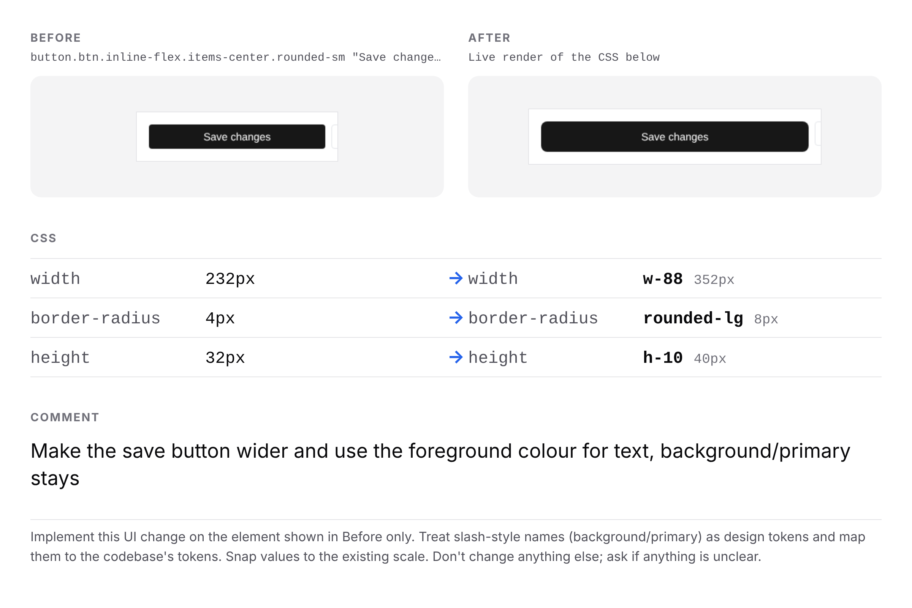
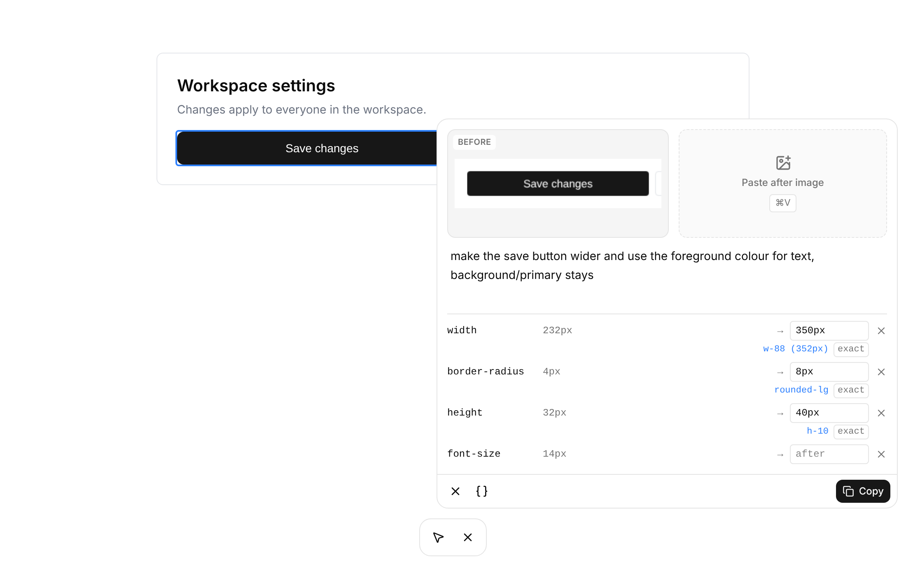

<div align="center">


# pinspec

**Pin a UI change on any page and copy it as one image your coding agent can act on.**

[](https://github.com/priyaabhatt/pinspec/actions/workflows/ci.yml)
[](https://github.com/priyaabhatt/pinspec/actions/workflows/release.yml)
[](LICENSE)

</div>

When a designer hands a developer a screenshot, the coding agent has to guess which element is meant, what the target values are, and which design tokens to use. pinspec writes the handoff for the agent instead: the exact element, its current CSS, the target, the values snapped to the codebase's design system, and the designer's comment, all in one PNG on the clipboard.

<p align="center">
  
</p>

## Features

- **Works on any page:** production, Vercel previews and localhost. It reads the rendered page; no source code or dev install needed.
- **Precise selection:** hover to highlight, ↑ and ↓ to move between parent and child, click to pick. Icons and elements under invisible overlays are easy to reach.
- **Before and After:** the element is captured automatically; paste the target image with ⌘V.
- **CSS rows:** tick the properties you want to change and type the new values. They're applied live on the page.
- **Snapped to the design system:** reads Tailwind v4 and shadcn tokens from the page, so `350px` becomes `w-88` and `#6B7280` becomes `text-muted-foreground`. Sites with their own names (`--space-4`, `--brand-primary`) snap to `var(--space-4)`. Mark any row **exact** to keep your value.
- **Private by design:** no backend, no network calls, nothing stored. The pin is gone once copied.

<p align="center">
  
</p>

## Install

### From the prebuilt branch (recommended)

Every merge to `main` builds the extension and publishes it to the [`extension`](https://github.com/priyaabhatt/pinspec/tree/extension) branch, ready to load.

```sh
git clone -b extension https://github.com/priyaabhatt/pinspec.git pinspec-extension
```

1. Open `chrome://extensions` and turn on **Developer mode**.
2. Click **Load unpacked** and choose the `pinspec-extension` folder.
3. Pin pinspec from the puzzle-piece menu.

To update, run `git pull` in that folder and click ↻ on pinspec's card in `chrome://extensions`.

### From source

Requires Node 20 or newer.

```sh
git clone https://github.com/priyaabhatt/pinspec.git
cd pinspec
npm install
npm run build
```

Then load the `dist` folder as above.

## Usage

1. Click the pinspec icon or press **⌥⇧P** (**Alt+Shift+P** on Windows and Linux). The toolbar appears and selection starts. The same shortcut turns pinspec off; change it at `chrome://extensions/shortcuts`.
2. Hover and click the element to change. The label shows where you are (`div.card › button.btn`). **↑** selects the parent, **↓** steps back down or into the child under the pointer, **Esc** cancels.
3. Write or dictate what should change. The comment is required.
4. Optional: press **⌘V** in the card to paste an After image.
5. Optional: click **{ }**, tick properties, then type their after values.
6. Click **Copy** (or press **⌘↵**) and paste the image into Codex, Claude Code or Cursor.

✕ or Esc cancels the pin. Dragging the toolbar moves it anywhere on the page.

### The copied image

| Section | Contents |
| --- | --- |
| Before | The selected element with a little surrounding context, plus its tag, classes and text |
| After | Your pasted image, or a live render of the CSS edits |
| CSS | Before → after rows, with the snapped token beside each value |
| Comment | Your comment, as typed or dictated |
| Footer | Short instructions telling the agent to change only this element and use existing tokens |

## Permissions and privacy

pinspec asks only for `activeTab` and `scripting`. It runs on a tab only after you click its icon, and it never sends data anywhere. Screenshots and the composed image stay in your browser until you paste them. See the [privacy policy](PRIVACY.md).

## Development

```sh
npm run dev        # rebuild the content script on save
npm run typecheck
npm test           # unit tests
npm run test:e2e   # builds, then drives the extension in Chromium on the dev pages
npm run build
```

After a rebuild, click ↻ on pinspec's card in `chrome://extensions` and reload the page. `dev/index.html` is a test page with a small Tailwind and shadcn token set, and `dev/custom-tokens.html` uses hand-rolled token names; serve them with `cd dev && python3 -m http.server`.

### Project structure

| Path | Purpose |
| --- | --- |
| `src/background/index.ts` | Injects or toggles pinspec on icon click; takes screenshots |
| `src/content/index.tsx` | Mounts the UI in a shadow root, isolated from the page |
| `src/content/App.tsx` | Pin state: selecting, the card, live edits and copy |
| `src/content/Selector.tsx` | Element selection overlay |
| `src/content/Card.tsx` | Annotation card, paste handling and CSS rows |
| `src/content/CssPicker.tsx` | Property picker with checkboxes and the class list |
| `src/content/tokens.ts` | Reads design tokens from the page's CSS |
| `src/lib/snap.ts` | Snapping logic (unit tested) |
| `e2e/pinspec.test.mjs` | End-to-end tests: pin flow, picker, selection, tall capture, custom tokens |
| `src/content/compose.ts` | Draws the final PNG |
| `build/postcss-shadow-safe.js` | Makes Tailwind's output work inside a shadow root |

Built with React, Tailwind CSS v4, shadcn/ui and Vite.

### Known limitations

- Tokens are read from same-origin stylesheets only; browsers block reading rules from other domains.
- Chrome doesn't allow extensions on `chrome://` pages or the Chrome Web Store.

## Releasing

Bump the version in `package.json` and `public/manifest.json`, merge, and push a tag such as `v0.2.0`. The Release workflow attaches `pinspec-0.2.0.zip` to a GitHub release. The Chrome Web Store listing text, graphics and submission steps are in [`store/`](store/README.md).

## Contributing

`main` only changes through pull requests. Branch from `main`, make sure `npm run typecheck`, `npm test`, `npm run test:e2e` and `npm run build` pass, and open a PR using the template. Bug reports and ideas are welcome in [Issues](https://github.com/priyaabhatt/pinspec/issues).

## License

[MIT](LICENSE) © 2026 Priya Bhatt
